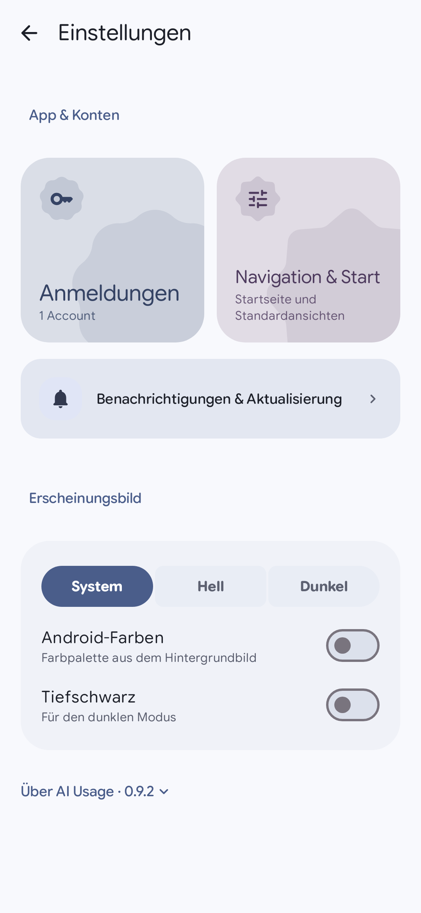
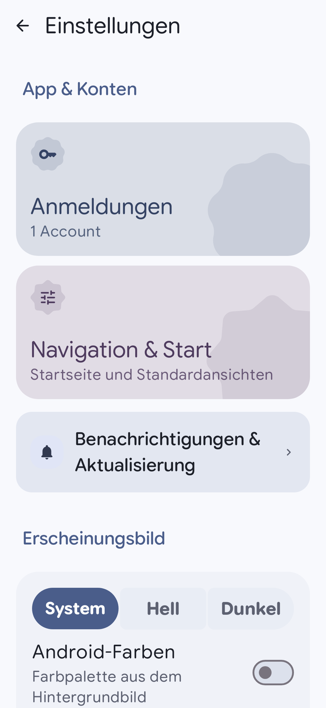
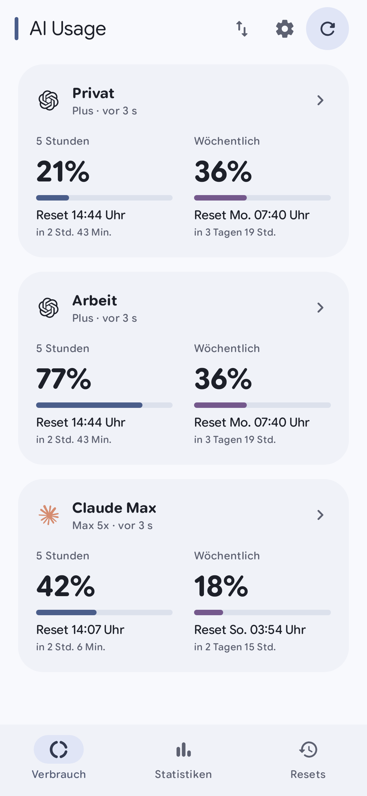
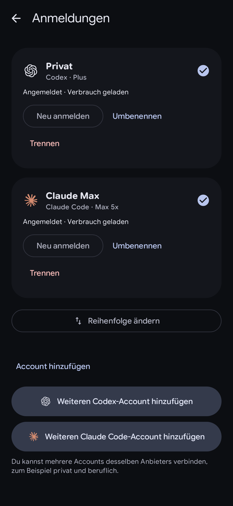
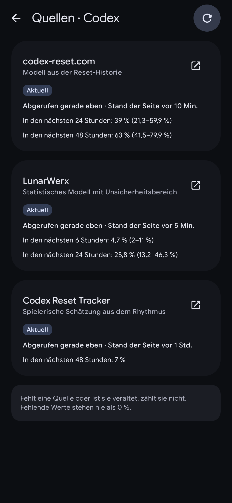
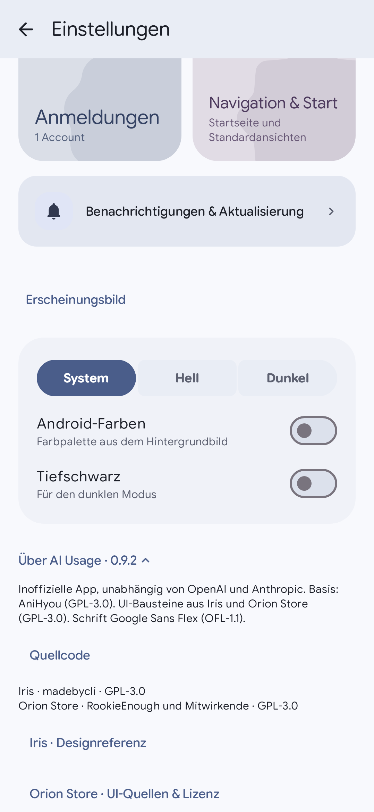

# AI Usage 0.9.2 · Iris-Designstand

Die UI-Bausteine stammen aus **Iris Build 102**, Commit `60bbb256e588103ad18f9776ed8acfdde7c6f156`. Der Iris-Zweig wird nicht verändert. Die untere Menüleiste von AI Usage bleibt ebenfalls erhalten.

Die Bilder zeigen echte Compose-Komponenten mit Testkonten auf Robolectric API 35 und nativer Grafik. Sie sind keine Aufnahmen eines Telefons; eine Prüfung auf dem Android-17-Gerät des Fehlerberichts steht aus. Die Bilder lassen sich anklicken und vergrößern.

| Einstellungen | Große Schrift, 160 % |
|---|---|
|  |  |

Bei großer Schrift oder sehr schmalem Inhalt stehen die Kacheln untereinander. Menüzeilen haben getrennte Flächen, flexible Textspalten und klar abgegrenzte Aktionen. Die Farbpalette bleibt Teil des vorhandenen AI-Usage-Themes.

| Verbrauch | Konten |
|---|---|
|  |  |

Karten verwenden den gestaffelten Eintritt und das Druckverhalten aus Iris/Orion. Wiederverwendete Einträge beginnen ihre Eintrittsanimation beim Scrollen nicht jedes Mal neu. Abschnittstitel und Formtokens sind vereinheitlicht; Messwerte und Bedeutungen bleiben erhalten.

| Reset-Quellen | Herkunft und Lizenz |
|---|---|
|  |  |

Die Darstellung verwendet Testdaten. Der separat behobene Abruffehler stammt von der Domainumstellung des Codex/Claude Reset Trackers: Die App ruft jetzt `pingreset.com` direkt auf. Der Schutz vor Weiterleitungen auf andere Domains bleibt aktiv.

[Übernommener Code und Umfang](../IRIS_DESIGN.md) · [Prüfstand](VERIFICATION.md)
